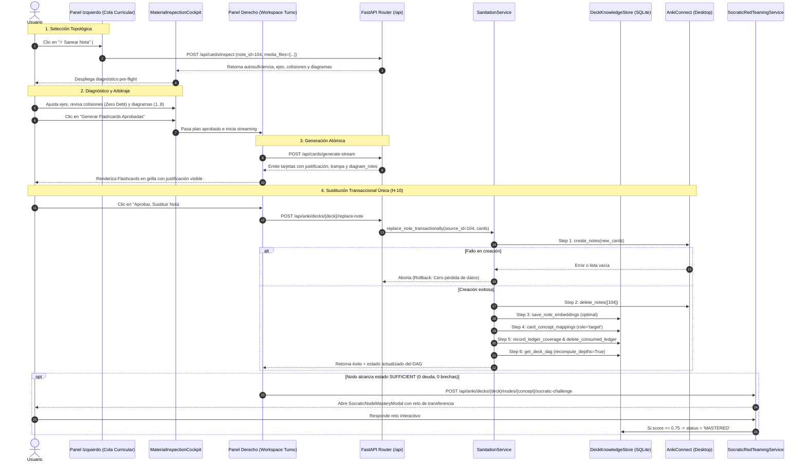

# Flujo Oficial de Saneamiento de Tarjetas (v2.0)

Este documento describe con rigor arquitectónico el recorrido operativo oficial para sanear una tarjeta en **AnkiCraft AI**, estructurado bajo el nuevo **Workspace Split-Pane**, los contratos transaccionales deterministas y el Grafo de Precedencia Cognitiva (DAG).

---

## 1. Grafo de Dependencias e Interacción (Arquitectura de Datos y Componentes)

---

## 2. Detalle Paso a Paso: ¿Qué hace el Usuario vs. Qué hace el Sistema?

### Paso 1: Posicionamiento y Selección Topológica
* **¿Qué hace el Usuario?**:
  1. Abre la aplicación (`http://localhost:5173`). El sistema inicia automáticamente en el modo **`🛠️ Saneamiento Curricular`**.
  2. Selecciona el mazo en el selector del encabezado (ej. *Oracle Cloud*).
  3. En el **Panel Izquierdo**, visualiza la **Cola Topológica Curricular** agrupada por niveles del DAG.
  4. Hace clic en el botón **`⚡ Sanear Nota`** de la primera tarjeta en turno (o de cualquier tarjeta con deuda `🔴 bad` de los fundamentos).
* **¿Qué hace el Sistema?**:
  1. `SanitationService.get_sanitation_queue` obtiene las notas vivas de AnkiConnect (`8765`), cruza con SQLite y ordena determinísticamente en 4 niveles (sin LLM):
     - Pertenencia a la etapa activa del contrato pedagógico (`stage_id`).
     - Nivel de profundidad en el grafo (`min_depth_level ASC`: raíces `Nivel 0` primero).
     - Prioridad por severidad de deuda (`'bad'` antes que `'unreviewed'`).
     - Índice en el orden topológico del DAG.
  2. `CurationQueueBanner` particiona las notas en secciones colapsables: `Nivel 0: Conceptos Raíz (Fundamentos)` y `Nivel 1+: Dependientes`.
  3. Al recibir el clic, `handleInspectSanitationNote` extrae el contenido, los campos raw y las imágenes adjuntas (`media_files`), e invoca `POST /api/cards/inspect` aislando la tarjeta de falsos positivos con ella misma (`source_note_id`).
  4. Abre el modal `MaterialInspectionCockpit.tsx`.

---

### Paso 2: Diagnóstico Pre-Flight y Arbitraje de Colisiones
* **¿Qué hace el Usuario?**:
  1. En el Cockpit, examina el puntaje de autosuficiencia (`0–100%`) y el diagnóstico pedagógico para principiantes.
  2. Revisa los **Ejes Temáticos (`CoreTheme`)** detectados y la cantidad recomendada de tarjetas por subtema.
  3. Observa las insignias de arbitraje temático contra el mazo:
     * `🟢 Cubierto en Turno Previo (Ledger)`: Eje resuelto al sanear una nota anterior; el sistema lo desmarca automáticamente (`0` tarjetas) para evitar duplicados.
     * `🟡 Deuda en Mazo (Colisión)`: Eje tocado por otra nota defectuosa; el sistema lo mantiene activo (`selected: true`) pero **garantiza que la otra nota no será destruida**.
     * `✨ Eje Inédito`: Subtema nuevo en el mazo; genera tarjetas atómicas.
  4. Si la nota tenía diagramas (1 a 8 imágenes), valida o reasigna qué imagen corresponde a qué eje temático mediante los selectores interactivos.
  5. Pulsa **`Generar X Flashcards Aprobadas`**.
* **¿Qué hace el Sistema?**:
  1. `InspectMaterialUseCase` analiza el material bajo la directriz obligatoria de rigor de primeros principios para nivel `beginner`.
  2. `DeckIntelligenceService.match_study_plan`:
     * Consulta `sanitation_coverage_ledger`: si el tema ya fue dominado en un turno previo, lo marca como `DOMINATED` (`selected: false`, `recommended_cards: 0`).
     * Detecta colisiones con notas con deuda y emite `COGNITIVE_DEBT` con `should_replace: false` (**Zero Debt Deletion: H-03**).
  3. Vincula hasta 8 imágenes en `associated_diagrams` y define sus roles funcionales en `diagram_roles`.
  4. Cierra el modal y transfiere el plan aprobado al Panel Derecho del Workspace.

---

### Paso 3: Síntesis Atómica y Verificación en el Workspace
* **¿Qué hace el Usuario?**:
  1. En el **Panel Derecho**, observa la síntesis progresiva de las flashcards atómicas.
  2. Puede interactuar con cada tarjeta (`FlashcardItem.tsx`) y verificar:
     * **Pregunta / Cloze atómico** (< 15–25 palabras) en el anverso.
     * **Respuesta concisa y sección `⚠️ Trampa frecuente / Error común:`** en el reverso.
     * **`💡 Justificación Pedagógica`**: Cuadro visible que explicita qué hecho cubre la tarjeta y por qué es necesaria.
     * **`🖼️ Diagramas Heredados`**: Chips con los nombres exactos de los diagramas asignados a ese subtema.
     * **Auditoría Neurocognitiva**: Badge en la barra de herramientas (`Calidad: X/100`) para ver el cumplimiento de reglas de Wozniak.
* **¿Qué hace el Sistema?**:
  1. `GenerateCardsUseCase` invoca a Gemini aplicando barreras negativas mutuas (solo notas en estado `optimal` actúan como prohibición semántica).
  2. Inyecta `source_images` de forma determinista por tarjeta según los `diagram_roles` configurados (sin alterar índices ni usar `.shift()`).
  3. Despliega en la cabecera de `FlashcardGrid` la **Barra de Commit Contextual Unificada**.

---

### Paso 4: Commit Transaccional Único (Sustitución en Anki)
* **¿Qué hace el Usuario?**:
  1. Al estar satisfecho con las tarjetas, pulsa el botón principal en la barra de la grilla:
     **`[ ✅ Aprobar, Sustituir Nota #ID y Siguiente ▶ ]`**.
  2. *(Alternativa para notas perfectas)*: Si la nota original no requería cambios, pulsa **`[ ✨ Conservar como Óptima ]`** para catalogarla sin alterar Anki.
* **¿Qué hace el Sistema?**:
  1. Invoca `api.replaceNoteTransactionally` (`POST /api/anki/decks/{deck}/replace-note`).
  2. **Paso 4.1 (Creación Segura)**: Llama a `_anki_bridge.create_notes`. Si AnkiConnect falla o devuelve lista vacía, aborta de inmediato con `RuntimeError` sin llamar jamás a `delete_notes` (**Cero Pérdida de Datos**).
  3. **Paso 4.2 (Eliminación Quirúrgica)**: Borra exclusivamente la nota monolítica original (`_anki_bridge.delete_notes([source_note_id])`).
  4. **Paso 4.3 (Indexación Real)**: Calcula embeddings reales con `_embedding_port.embed_texts` y guarda las tarjetas en SQLite `indexed_notes` como `quality_status = 'optimal'`.
  5. **Paso 4.4 (Vínculos DAG)**: Enlaza los nuevos `note_id` en `card_concept_mappings` con `role = 'target'`.
  6. **Paso 4.5 (Ledger de Colisiones)**: Inserta las notas con deuda absorbidas en `sanitation_coverage_ledger` y purga las entradas consumidas del turno actual con `delete_ledger_entries_for_note`.
  7. **Paso 4.6 (Recálculo DAG)**: Ejecuta `get_deck_dag(recompute_depths=True)` garantizando que el nodo avance a `SANITIZED`.
  8. **Paso 4.7 (Transición Automática)**: `App.tsx` refresca la cola; la nota procesada desaparece del panel izquierdo y la siguiente toma la primera posición.

---

### Paso 5: Certificación Socrática de Cierre de Nodo
* **¿Qué hace el Usuario?**:
  1. Si la nota reemplazada era la última con deuda de un concepto del DAG (el nodo alcanza 100% de tarjetas óptimas y 0 brechas: estado `SUFFICIENT`), el sistema abre automáticamente el modal:
     **`SocraticNodeMasteryModal.tsx`**.
  2. Lee el escenario de transferencia o caso límite generado por la IA y escribe su respuesta explicativa.
* **¿Qué hace el Sistema?**:
  1. `SocraticRedTeamingService.evaluate_response` califica la respuesta con rigor pedagógico:
     * **Si score $\ge 0.75$**: Actualiza el nodo en SQLite `concept_nodes` a **`MASTERED` (Dominado)**, incrementa el progreso global del mazo y desbloquea el siguiente nivel en el DAG.
     * **Si score $< 0.75$ por brecha del mazo**: Inserta un `OrphanGap` en el nodo y regresa el estado a `SANITIZED` para generar la tarjeta complementaria.
     * **Si score $< 0.75$ por olvido del usuario**: Conserva el estado `SUFFICIENT` y muestra la tarjeta exacta del mazo con su sección `⚠️ Trampa frecuente`.
