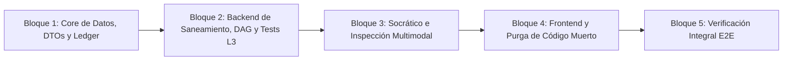

# Especificación Oficial: Arquitectura de Saneamiento Curricular, Suficiencia Pedagógica y Evolución del Mazo (v2.0)

> **Fecha**: 2026-10-13  
> **Estado**: Especificación Oficial Canónica y Aprobada para Implementación  
> **Archivo**: `docs/SANITATION_WORKFLOW_AUDIT.md` (Reemplaza íntegramente la versión v1 de diagnóstico)  
> **Alcance**: Unificación del flujo de saneamiento en la ventana principal (`frontend/src/App.tsx`), gobernanza estricta por el Grafo de Precedencia (`DeckDAGService`), motor de "Analizar y Planificar" (`MaterialInspectionCockpit.tsx`), memoria contextual diferida para colisiones (`sanitation_coverage_ledger`), herencia multimodal inteligente (1–8 imágenes por eje), auditoría de suficiencia para principiantes, reto socrático interactivo por nodo y Plan de Estudios dinámico multi-etapa.

---

## 1. Auditoría de Código: 10 Hallazgos Críticos Confirmados

Tras auditar exhaustivamente el código fuente del backend y del frontend, se documentan los **10 defectos estructurales y funcionales** verificados que impedían un saneamiento profesional y consistente:

### H-01. Desconexión entre el Orden Topológico del DAG y la Cola de Saneamiento
* **Evidencia**: En [`backend/app/services/sanitation_service.py`](file:///c:/Users/Manolo/Desktop/Antigravity%20Proyects/Anki%20Flashcards%20IA/backend/app/services/sanitation_service.py#L126-L133), `SanitationService.get_sanitation_queue` ordena las notas pendientes únicamente con una función local `_sort_priority(n)` que prioriza `'bad'` (`0`), `'preevaluated'` (`1`) y `'unreviewed'` (`2`).
* **Impacto**: No consulta `DeckDAGService.get_topological_card_order(deck_name)`. El usuario termina saneando tarjetas de conceptos avanzados (hojas del grafo) antes de haber saneado y consolidado los conceptos fundamentales (raíces con `depth_level = 0`).

### H-02. "Sanear Clúster" omite por completo el motor de "Analizar y Planificar"
* **Evidencia**: En [`frontend/src/components/ClusterSanitationModal.tsx`](file:///c:/Users/Manolo/Desktop/Antigravity%20Proyects/Anki%20Flashcards%20IA/frontend/src/components/ClusterSanitationModal.tsx), el botón *"Generar Propuesta Atómica"* llama a `api.generateClusterNoteCandidates` $\to$ `SanitationService.generate_note_sanitation_candidates`, el cual invoca directo a `generator_service.execute_from_text` o `execute_from_media` sin invocar jamás a `InspectMaterialUseCase` (`POST /cards/inspect`) ni a `DeckIntelligenceService.match_study_plan` (`POST /anki/decks/match-study-plan`).
* **Impacto**: Se pierde la evaluación de autosuficiencia (`self_sufficiency_score`), la detección de prerrequisitos faltantes (`PrerequisiteItem`), la partición de notas monolíticas en ejes temáticos explícitos (`CoreTheme`), el cálculo de tarjetas recomendadas (`recommended_cards`) y el cruce semántico contra todo el mazo.

### H-03. Ruptura de vínculos con el Grafo (DAG) tras sustitución transaccional
* **Evidencia**: En [`backend/app/services/sanitation_service.py`](file:///c:/Users/Manolo/Desktop/Antigravity%20Proyects/Anki%20Flashcards%20IA/backend/app/services/sanitation_service.py#L208-L230), tras insertar las nuevas tarjetas en Anki y eliminar la nota monolítica, el código ejecuta `DELETE FROM card_concept_mappings WHERE deck_name = ? AND note_id = ?`. Luego guarda las nuevas tarjetas en `indexed_notes`, pero **nunca inserta los nuevos `created_note_ids` en `card_concept_mappings`**.
* **Impacto**: En `DeckDAGService.get_deck_dag`, el estado del nodo (`ConceptNode.status`) depende de las tarjetas vinculadas en `card_concept_mappings` con `role == 'target'`. Al borrar el vínculo viejo y no registrar los nuevos, el nodo queda con `card_count = 0` y se degrada erróneamente a `UNMAPPED` (`is_orphan = True`) en vez de avanzar a `SANITIZED`.

### H-04. Asunción negativa sobre notas vecinas de mala calidad en `negative_boundaries`
* **Evidencia**: `get_cluster_sanitation_preview` y `generate_note_sanitation_candidates` en `sanitation_service.py`, junto con `GenerateCardsUseCase._apply_mutual_negative_boundaries` en `generate_cards_service.py`, inyectan descriptores vecinos bajo la directiva `"PROHIBIDO evaluar conceptos vecinos: ..."` sin comprobar el `quality_status` de las notas vecinas.
* **Impacto**: Si la nota monolítica A toca los temas X e Y, y en el mazo existe una nota B que menciona Y pero tiene `quality_status == 'bad'`, el sistema prohíbe generar Y asumiendo que ya está cubierto. Además, no existía memoria para recordar en el turno futuro de B qué partes ya fueron cubiertas en el turno de A.

### H-05. Herencia ciega de imágenes por `.shift()` secuencial
* **Evidencia**: En [`backend/app/domain/models.py`](file:///c:/Users/Manolo/Desktop/Antigravity%20Proyects/Anki%20Flashcards%20IA/backend/app/domain/models.py#L27-L34), `Flashcard` solo define `source_image_index: Optional[int]` y `source_image: Optional[str]` (singular). En [`frontend/src/App.tsx#L1014-L1035`](file:///c:/Users/Manolo/Desktop/Antigravity%20Proyects/Anki%20Flashcards%20IA/frontend/src/App.tsx#L1014-L1035), las imágenes heredadas se reparten secuencialmente con `mediaToInherit.shift()!` y el sobrante se amontona completo en `generatedCards[0]`.
* **Impacto**: Cuando una nota monolítica tiene hasta 8 imágenes donde varias pertenecen a un mismo subtema (ej. 3 capturas de un flujo de configuración), el `.shift()` asigna diagramas a tarjetas que tratan otros subtemas o concentra el sobrante en la primera tarjeta.

### H-06. Eliminación prematura de notas colisionadas sin respetar su propio turno
* **Evidencia**: En [`frontend/src/components/MaterialInspectionCockpit.tsx#L373-L391`](file:///c:/Users/Manolo/Desktop/Antigravity%20Proyects/Anki%20Flashcards%20IA/frontend/src/components/MaterialInspectionCockpit.tsx#L373-L391), `handleApproveInspection` recorre los prerrequisitos y ejes temáticos y, ante cualquier coincidencia con `status === 'cognitive_debt'`, añade su `matched_note_id` al arreglo `obsoleteIds` para borrarla de Anki junto con la nota actual.
* **Impacto**: Destruye tarjetas existentes con deuda cognitiva sin darles su propio turno de análisis y sin verificar si contenían otros conceptos exclusivos que no estaban en la nota actual.

### H-07. Fragmentación en modales redundantes y estado huérfano
* **Evidencia**: En [`frontend/src/App.tsx#L167-L242`](file:///c:/Users/Manolo/Desktop/Antigravity%20Proyects/Anki%20Flashcards%20IA/frontend/src/App.tsx#L167-L242), `isSanitationMode` depende de `sessionStorage` con el mazo `'Oracle Cloud'` fijo en el código y sin botón de activación en la UI. Coexisten dos colas separadas (`sanitationQueue` y `curationQueue`). `ClusterSanitationModal.tsx` vive dentro de `DeckStudioModal.tsx` y `RefactorNoteModal.tsx` mantiene una edición in-situ paralela.
* **Impacto**: El usuario se pierde entre flujos desconectados y pantallas duplicadas.

### H-08. Ausencia de auditoría de "Suficiencia para Principiante" y "Reto Socrático" al cerrar un nodo
* **Evidencia**: En `DeckDAGService.get_deck_dag`, un nodo recibe `status = "SANITIZED"` simplemente cuando `all(st == "optimal" for st in mapped_statuses)`. `SocraticRedTeamingService` solo se usaba en pruebas de estrés automatizadas (`Level 5 Audit`).
* **Impacto**: Que las tarjetas existentes de un nodo estén bien escritas no garantiza que cubran el 100% de lo que necesita un principiante sin brechas. Tampoco se valida interactivamente el modelo mental del usuario antes de desbloquear temas avanzados.

### H-09. Contrato de Plan de Estudios estático y de una sola etapa
* **Evidencia**: [`backend/app/domain/models.py#L700-L715`](file:///c:/Users/Manolo/Desktop/Antigravity%20Proyects/Anki%20Flashcards%20IA/backend/app/domain/models.py#L700-L715), `LearningPlanContract` solo guarda 4 atributos globales para todo el mazo (`bloom_level`, `exclusion_boundary`, `gap_strategy`, `operational_depth`).
* **Impacto**: No permite definir etapas evolutivas (ej. Etapa 1: Fundamentos de Redes de 0 a 100 $\rightarrow$ Etapa 2: AWS / Cisco / OCI) ni modularizar el progreso y los prerrequisitos entre fundamentos y especializaciones.

### H-10. Doble vía de reemplazo de notas en Anki desincronizada
* **Evidencia**: Coexisten dos caminos de reemplazo:
  1. *Vía de producción en uso*: `handleConfirmGenerateFromInspection` guarda `obsolete_note_ids` en `pendingObsoleteNoteIds`. Luego `handleExportToAnki` llama a `POST /cards/export/anki` $\to$ `ExportDeckUseCase.export_to_anki`, el cual marca notas como `preevaluated`, borra las obsoletas, pero **no actualiza `card_concept_mappings`, ni el DAG, ni la cola de saneamiento**.
  2. *Vía huérfana de saneamiento*: `handleExecuteSanitationReplace` llama a `POST /anki/decks/{deck_name}/replace-note` $\to$ `SanitationService.replace_note_transactionally`.
* **Impacto**: Si solo se repara `replace_note_transactionally`, el flujo cotidiano del usuario seguiría ejecutando `export_to_anki`, eludiendo todas las garantías del DAG y la cola.

---

## 2. Invariantes y Decisiones Oficiales de Arquitectura

1. **Vía Única de Reemplazo en Anki**:
   - Toda operación de sustitución donde exista una nota origen (`selectedAnkiCard` o `inspection.source_note_id != null`) se canaliza exclusivamente por `POST /anki/decks/{deck_name}/replace-note` (`SanitationService.replace_note_transactionally`).
   - Se elimina `pendingObsoleteNoteIds` en `App.tsx` y se retira el borrado de notas en `ExportDeckUseCase.export_to_anki`. `POST /cards/export/anki` queda reservado exclusivamente para inserción de tarjetas nuevas puras (texto libre, archivos o expansión de brechas sin nota origen).
2. **Unificación Total en la Ventana Principal (`App.tsx`)**:
   - Todo el saneamiento vive en la ventana principal, integrando la **Cola Topológica Unificada de Saneamiento** y el cockpit de **"Analizar y Planificar" (`MaterialInspectionCockpit.tsx`)**.
   - **Eliminación definitiva**: Se eliminan del proyecto `frontend/src/components/ClusterSanitationModal.tsx` y `frontend/src/components/RefactorNoteModal.tsx`, así como los 3 endpoints de saneamiento de clústeres en backend.
   - **Rol de `AnkiCardPickerModal.tsx`**: Se conserva como selector manual para cargar cualquier nota puntual en el flujo de *"Analizar y Planificar"* en la ventana principal.
   - **Rol de Clústeres**: Pasan a ser exclusivamente agrupaciones visuales de lectura en `get_deck_coverage_map` y la Pestaña 1 de `DeckStudioModal.tsx`. El botón en esa vista se convierte en *"Sanear este Eje en Cola Principal"*, hand-off a `App.tsx`.
3. **Unificación del Estado `preevaluated` en `optimal`**:
   - Todas las tarjetas generadas por el pipeline pasan a indexarse directamente con `quality_status = "optimal"`.
   - Se migra la base de datos: `UPDATE indexed_notes SET quality_status = 'optimal' WHERE quality_status = 'preevaluated'`.
   - Quedan únicamente 3 estados canónicos:
     - `unreviewed`: Nota en Anki aún no auditada ni saneada.
     - `bad`: Nota auditada con deuda cognitiva confirmada.
     - `optimal`: Nota atómica verificada (bloquea duplicados como `DOMINATED` y suma al % de saneamiento).
4. **Política de Colisiones con Tarjetas de Mala Calidad (Turno Propio con Memoria Contextual)**:
   - Si la nota en turno A colisiona con una nota existente B en estado `bad` o `unreviewed`, el sistema **no asume que el tema está cubierto, no prohíbe generarlo en A, y no elimina B prematuramente**.
   - Genera en el turno de A las tarjetas atómicas con su justificación pedagógica, mantiene a B en la cola para su propio turno, y registra en `sanitation_coverage_ledger` qué conceptos de B fueron resueltos por las tarjetas creadas en A.
   - En el turno futuro de B, *"Analizar y Planificar"* consulta el ledger, marca como `DOMINATED` los ejes resueltos por A y solo planifica tarjetas para los conceptos exclusivos restantes de B.
5. **Eliminación Total del Monolito Original**:
   - Una vez verificado que AnkiConnect insertó las tarjetas nuevas, la nota monolítica original se elimina definitivamente (`delete_notes`).
6. **Herencia Multimodal Inteligente por Eje (1 a 8 Imágenes)**:
   - `InspectMaterialUseCase` clasifica las imágenes (1 a 8) y asocia a cada `CoreTheme` su subconjunto exacto en `associated_diagrams` y `diagram_roles`.
   - `Flashcard` incorpora `source_images: List[str]` para que cada tarjeta atómica herede exactamente las imágenes de su eje, eliminando la distribución secuencial `.shift()`.
7. **Cierre de Nodo del DAG: Suficiencia Pedagógica + Reto Socrático Interactivo**:
   - Al completar todas las tarjetas de un nodo (`optimal` al 100%), se ejecuta la **Auditoría de Suficiencia para Principiante**. Si hay brechas (`orphan_gaps`), se generan las tarjetas faltantes.
   - Con 0 brechas (`status = "SUFFICIENT"`), se activa el **Reto Socrático Interactivo** (umbral de aprobación $\ge 0.75$).
   - Si aprueba: `ConceptNode.status = "MASTERED"`.
   - Si reprueba por brecha del mazo: se crea un `OrphanGap` automático y regresa a `SANITIZED`.
   - Si reprueba por olvido del usuario (dato ya presente en el mazo): se muestra la tarjeta explicativa con su trampa común y se permite reintentar o posponer sin degradar el nodo.
8. **Plan de Estudios Dinámico Multi-Etapa con `stage_id` en DAG**:
   - Cada nodo en `concept_nodes` tiene columna `stage_id TEXT DEFAULT 'stage_1'`.
   - La cola de saneamiento ordena por etapa activa, luego por `min_depth_level ASC` (fundamentos primero), luego por severidad de deuda (`bad` > `unreviewed`).
   - Las notas sin extraer en el DAG reciben `depth_level = 999` (0 llamadas a LLM en el GET de la cola) y se auto-vinculan al pasar por *"Analizar y Planificar"*.

---

## 3. Arquitectura del Flujo Unificado (End-to-End)

```mermaid
flowchart TD
    subgraph S1 ["1. Gobernanza Curricular y Topología"]
        LPC[LearningPlanContract Multi-Etapa<br/>Etapa 1: Fundamentos 0 a 100 -> Etapa 2: Cloud/Certificación]
        DAG[DeckDAGService: concept_nodes con stage_id y depth_level<br/>Raíces depth=0 -> Nodos intermedios -> Hojas]
        LPC --> DAG
    end

    subgraph S2 ["2. Cola Topológica Unificada en Ventana Principal (App.tsx)"]
        DAG --> QUEUE[SanitationService.get_sanitation_queue<br/>1° Etapa Activa | 2° depth_level ASC | 3° bad > unreviewed]
        MANUAL[AnkiCardPickerModal: Selección Manual] --> ACTIVE_NOTE[Nota en Turno Activo]
        QUEUE --> ACTIVE_NOTE
    end

    subgraph S3 ["3. Cockpit de Analizar y Planificar (MaterialInspectionCockpit)"]
        ACTIVE_NOTE --> INSPECT[InspectMaterialUseCase + Agrupación Multimodal<br/>Asigna 1..8 imágenes por CoreTheme]
        INSPECT --> MATCH[DeckIntelligenceService.match_study_plan<br/>Cruce con sanitation_coverage_ledger]
        MATCH -->|Colisión con Óptima| DOM[Eje DOMINATED<br/>Omitido con justificación de tarjeta existente]
        MATCH -->|Colisión con Mala B| DEBT[Eje ACTIVO en Turno A<br/>Alerta de deuda en B y registro en Ledger]
    end

    subgraph S4 ["4. Generación Atómica y Sustitución Transaccional"]
        DOM --> GEN[GenerateCardsUseCase<br/>Tarjetas atómicas con justification y source_images exactas]
        DEBT --> GEN
        GEN --> COMMIT[SanitationService.replace_note_transactionally<br/>1. create_notes en Anki<br/>2. delete_notes monolito original<br/>3. embed_texts + indexed_notes optimal<br/>4. Vínculo en card_concept_mappings<br/>5. Registro en sanitation_coverage_ledger]
    end

    subgraph S5 ["5. Certificación Dual del Nodo y Reto Socrático"]
        COMMIT --> CHECK_NODE{¿Todas las notas del<br/>nodo están en optimal?}
        CHECK_NODE -- No --> QUEUE
        CHECK_NODE -- Sí --> SUFF_AUDIT[Auditoría de Suficiencia para Principiante<br/>¿Cubre el tema de 0 a 100?]
        SUFF_AUDIT -- Hay Brechas --> GAP_CARDS[Generar Tarjetas Atómicas de Brechas]
        GAP_CARDS --> SUFF_AUDIT
        SUFF_AUDIT -- 0 Brechas (SUFFICIENT) --> SOCRATIC[Reto Socrático Interactivo del Nodo<br/>SocraticRedTeamingService (Umbral 0.75)]
        SOCRATIC -- Aprobado --> MASTERED[Nodo MASTERED<br/>Desbloquea dependientes / Etapa 2]
        SOCRATIC -- Reprobado por brecha del mazo --> GAP_CARDS
        SOCRATIC -- Reprobado por olvido de usuario --> RETRY[Mostrar Tarjeta y Trampa Común<br/>Reintento disponible]
    end
```

---

## 4. Modelos de Datos y Migraciones SQLite

### 4.1. Nueva Tabla: `sanitation_coverage_ledger`
```sql
CREATE TABLE IF NOT EXISTS sanitation_coverage_ledger (
    id INTEGER PRIMARY KEY AUTOINCREMENT,
    deck_name TEXT NOT NULL,
    source_sanitized_note_id INTEGER NOT NULL,
    colliding_pending_note_id INTEGER NOT NULL,
    covered_concept_title TEXT NOT NULL,
    covered_facet_summary TEXT,
    created_atomic_note_ids TEXT NOT NULL, -- JSON List[int]
    created_at TEXT NOT NULL
);
CREATE INDEX IF NOT EXISTS idx_ledger_pending_note
    ON sanitation_coverage_ledger(deck_name, colliding_pending_note_id);
```

### 4.2. Migración en `concept_nodes`
```sql
-- En DeckKnowledgeStore._init_db():
ALTER TABLE concept_nodes ADD COLUMN stage_id TEXT DEFAULT 'stage_1';
CREATE INDEX IF NOT EXISTS idx_concept_nodes_stage
    ON concept_nodes(deck_name, stage_id);
```

### 4.3. Migración de Estados de Calidad
```sql
UPDATE indexed_notes SET quality_status = 'optimal' WHERE quality_status = 'preevaluated';
```

### 4.4. Extensiones en Pydantic (`backend/app/domain/models.py`)
```python
class LearnerExpertiseLevel(str, Enum):
    BEGINNER = "beginner"
    INTERMEDIATE = "intermediate"
    ADVANCED = "advanced"

class CurriculumStage(BaseModel):
    stage_id: str
    order_index: int
    title: str
    target_learner_level: LearnerExpertiseLevel = LearnerExpertiseLevel.BEGINNER
    bloom_level: str = "Comprensión y Mecanismos Causales"
    core_domains: List[str] = Field(default_factory=list)
    exclusion_boundary: List[str] = Field(default_factory=list)
    blueprint_exam_name: Optional[str] = None
    status: str = "active"  # 'active' | 'queued' | 'completed'
    sanitation_progress_pct: float = 0.0
    sufficiency_coverage_pct: float = 0.0

# En Flashcard:
source_images: List[str] = Field(default_factory=list, description="Anki media filenames for visual support")

# En CoreTheme:
diagram_roles: Dict[str, str] = Field(default_factory=dict, description="filename -> purpose explanation")

# En ConceptNode:
stage_id: str = "stage_1"

# En MatchStudyPlanRequest (Ajuste 1):
source_note_id: Optional[int] = Field(default=None, description="ID de la nota monolítica en turno para consultar el ledger")

# En TransactionalReplaceRequest (Ajuste 2):
class SanitationCoverageLedgerInput(BaseModel):
    colliding_note_id: int
    concept_title: str
    facet_summary: Optional[str] = None

target_concepts: List[str] = Field(default_factory=list, description="Títulos de los CoreThemes aprobados")
pending_ledger_collisions: List[SanitationCoverageLedgerInput] = Field(
    default_factory=list,
    description="Colisiones con notas bad/unreviewed a registrar en el ledger"
)
```

---

## 5. Plan de Ejecución Secuencial y Granular

El plan está dividido en **5 Bloques Rigurosos** ordenados por dependencias de compilación y pruebas:



### Bloque 1: Core de Dominio, Base de Datos SQLite y Migraciones
1. **`backend/app/domain/models.py`**:
   - Añadir `source_images: List[str]` en `Flashcard`.
   - Añadir `diagram_roles: Dict[str, str]` en `CoreTheme`.
   - Añadir `LearnerExpertiseLevel`, `CurriculumStage` y `stages: List[CurriculumStage]` en `LearningPlanContract`.
   - Añadir `stage_id: str = "stage_1"` en `ConceptNode`.
   - Añadir `source_note_id: Optional[int] = None` en `MatchStudyPlanRequest` (Micro-ajuste 1).
   - Añadir `SanitationCoverageLedgerInput`, `target_concepts` y `pending_ledger_collisions` en `TransactionalReplaceRequest` (Micro-ajuste 2).
   - Añadir modelo `SanitationCoverageLedgerEntry` y DTOs para el reto socrático interactivo.
2. **`backend/app/adapters/db/deck_knowledge_store.py`**:
   - Crear tabla `sanitation_coverage_ledger` e índices en `_init_db`.
   - Añadir columna `stage_id` en `concept_nodes` con fallback defensivo si ya existe.
   - Ejecutar la migración de `quality_status = 'optimal'` para notas `'preevaluated'`.
   - Implementar métodos:
     - `record_ledger_coverage(deck_name, source_id, colliding_id, concept_title, facet_summary, new_note_ids)`
     - `get_ledger_entries_for_note(deck_name, note_id) -> List[Dict]`
     - `delete_ledger_entries_for_note(deck_name, note_id)`
3. **Verificación Bloque 1**:
   - Tests unitarios de base de datos (`pytest backend/tests/test_deck_knowledge_store.py`).

### Bloque 2: Backend de Saneamiento, Orden Topológico, Vía Única de Reemplazo y Sincronización de Tests L3
1. **`backend/app/services/sanitation_service.py`**:
   - Inyectar `IEmbeddingPort` en el constructor de `SanitationService`.
   - Reescribir `get_sanitation_queue`:
     - Consultar `get_deck_dag` y `get_topological_card_order`.
     - Notas mapeadas: `depth_level` mínimo del nodo. Notas no mapeadas: `depth_level = 999`.
     - Ordenamiento: (1) etapa activa, (2) `depth_level ASC`, (3) `'bad'` antes que `'unreviewed'`, (4) índice topológico. 0 llamadas a LLM.
   - Reescribir `replace_note_transactionally`:
     - Insertar nuevas notas en Anki con `_anki_bridge.create_notes`.
     - Borrar la nota original con `_anki_bridge.delete_notes([source_note_id])`.
     - Generar embeddings reales de las nuevas tarjetas y guardarlas en `indexed_notes` con `optimal`.
     - Transferir/asignar vínculos en `card_concept_mappings` con `role = 'target'` para cada tarjeta nueva según `target_concepts`.
     - Registrar entradas de `pending_ledger_collisions` en `sanitation_coverage_ledger`.
     - Purgar el ledger de la nota procesada con `delete_ledger_entries_for_note(deck_name, source_note_id)` y limpiar `note_extracted_knowledge` para esa nota (Micro-ajuste 3).
     - Recalcular el DAG con `recompute_depths=True` y reportar si algún nodo alcanzó el 100% de tarjetas óptimas.
   - Eliminar métodos obsoletos: `sanitize_cluster` y `generate_note_sanitation_candidates`.
2. **`backend/app/services/export_deck_service.py`**:
   - Retirar el parámetro `obsolete_note_ids` y la lógica de borrado de notas en `export_to_anki`.
   - `export_to_anki` indexa las tarjetas nuevas directamente como `optimal`.
3. **`backend/app/api/routes.py`**:
   - Eliminar endpoints de saneamiento de clústeres:
     - `GET /anki/decks/{deck_name}/clusters/{cluster_index}/sanitation-preview`
     - `POST /anki/decks/{deck_name}/clusters/{cluster_index}/sanitize`
     - `POST /anki/decks/{deck_name}/clusters/{cluster_index}/notes/{note_id}/generate-candidates`
   - Retirar `obsolete_note_ids` del payload de `/cards/export/anki`.
4. **Sincronización de Tests de Auditoría Nivel 3 (Micro-ajuste 4)**:
   - Actualizar `backend/tests/test_sanitation_service.py` y `backend/audits/test_l3_sanitizer_safety.py` (caso L3.3) retirando llamadas a los métodos eliminados de clústeres y validando en su lugar el ordenamiento topológico del DAG, la transferencia en `card_concept_mappings` y el registro/purga en `sanitation_coverage_ledger`.
5. **Verificación Bloque 2**:
   - Ejecutar `pytest backend/tests/test_sanitation_service.py` y `pytest backend/audits/test_l3_sanitizer_safety.py`.

### Bloque 3: Memoria de Colisiones, Inspección Multimodal (1-8 imágenes) y Reto Socrático
1. **`backend/app/services/deck_intelligence_service.py`**:
   - En `match_study_plan`:
     - Usar `source_note_id` (o fallback a `exclude_note_ids[0]`) para consultar `get_ledger_entries_for_note`.
     - Si un eje ya fue cubierto en un turno anterior, marcarlo automáticamente como `DOMINATED` con detalle de las tarjetas previas.
     - Si colisiona con una nota `bad` o `unreviewed`, marcar como `COGNITIVE_DEBT` sin añadirla a notas obsoletas, manteniendo el eje activo para generar en el turno actual y retornando la colisión para ser aprobada en el plan.
2. **`backend/app/services/inspect_material_service.py`**:
   - Extraer hasta 8 imágenes de la nota con `retrieve_media_base64`.
   - Instruir al modelo multimodal para agrupar imágenes por `CoreTheme` (`associated_diagrams` y `diagram_roles`).
   - Inyectar el nivel del estudiante (`beginner` $\to$ rigor de primeros principios).
3. **`backend/app/services/socratic_red_teaming_service.py` y `backend/app/api/routes.py`**:
   - Crear servicio y endpoints para el Reto Socrático interactivo del Nodo:
     - `POST /anki/decks/{deck_name}/nodes/{concept_id}/socratic-challenge`: Genera el desafío para un nodo en estado `SUFFICIENT`.
     - `POST /anki/decks/{deck_name}/nodes/{concept_id}/socratic-evaluate`: Evalúa la respuesta del usuario (umbral 0.75). Si aprueba, sella el nodo como `MASTERED`. Si reprueba por brecha del mazo, inserta `OrphanGap`.
4. **Verificación Bloque 3**:
   - Tests de `match_study_plan` con ledger y tests del evaluador socrático.

### Bloque 4: Frontend, Purga de Código Muerto y Unificación en App.tsx
1. **Eliminar Archivos Físicos**:
   - Eliminar [`frontend/src/components/ClusterSanitationModal.tsx`](file:///c:/Users/Manolo/Desktop/Antigravity%20Proyects/Anki%20Flashcards%20IA/frontend/src/components/ClusterSanitationModal.tsx).
   - Eliminar [`frontend/src/components/RefactorNoteModal.tsx`](file:///c:/Users/Manolo/Desktop/Antigravity%20Proyects/Anki%20Flashcards%20IA/frontend/src/components/RefactorNoteModal.tsx).
2. **`frontend/src/components/DeckStudioModal.tsx`**:
   - Purgar importaciones y estados de `ClusterSanitationModal` y `RefactorNoteModal`.
   - Sustituir el botón *"Sanear Clúster"* en la Pestaña 1 por *"Sanear este Eje en Cola Principal"*, que cierra el modal y activa la cola en `App.tsx` en el concepto correspondiente.
3. **`frontend/src/components/MaterialInspectionCockpit.tsx`**:
   - Purgar la adición de notas con `cognitive_debt` a `obsoleteIds`.
   - Mostrar insignias de `sanitation_coverage_ledger` (*"Cubierto en turno previo"*).
   - Permitir al usuario reasignar visualmente las imágenes (1..8) entre ejes antes de generar.
4. **`frontend/src/App.tsx`**:
   - Purgar `isSanitationMode`, `sanitationQueue` huérfana de `sessionStorage` y `pendingObsoleteNoteIds`.
   - Unificar la barra de cola en la ventana principal (`CurationQueueBanner.tsx` conectado a `get_sanitation_queue`).
   - Unificar el botón de commit: cuando hay una nota origen activa, el botón de exportación ejecuta exclusivamente `api.replaceNoteTransactionally`. Cuando no hay nota origen, ejecuta `api.exportToAnki`.
   - Reemplazar el reparto `.shift()` de imágenes por la inyección directa de `card.source_images`.
5. **Nuevo Componente `SocraticNodeMasteryModal.tsx`**:
   - Modal interactivo desplegado cuando el usuario cierra todas las brechas de un nodo para realizar el Reto Socrático y certificarlo como `MASTERED`.
6. **Verificación Bloque 4**:
   - Comprobación de tipos TypeScript estricta (`npm run build` o `npx tsc -p tsconfig.app.json --noEmit`).
   - Linter (`npm run lint`).

### Bloque 5: Verificación Integral de Flujo y Pruebas E2E
1. Actualizar `frontend/e2e/flow_b_surgical_sanitation.spec.ts` para ejecutar el flujo vivo en `App.tsx` sin inyectar `sessionStorage`.
2. Ejecutar suite completa de tests backend (`pytest backend/tests/`) y auditorías de cobertura.
